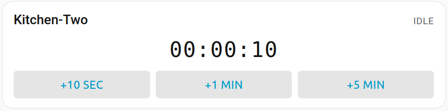
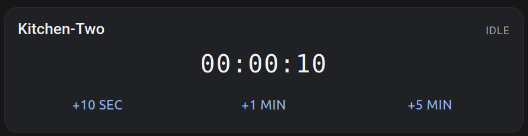

# Smart Timer




A configurable, multi-instance **Smart Timer** for Home Assistant: a backend
custom integration that creates one timer device per config entry, plus a
dashboard card with interactive `+10 SEC` / `+1 MIN` / `+5 MIN` shortcuts and a
triple-tap-to-reset action. When a timer reaches zero it plays a sound you
choose and fires the `smart_timer_on_fire` event you can hook into.

---

## Features

- **Multiple devices** — create as many independent Smart Timers as you like
  (e.g. *Pizza*, *Episode*, *Yoga*), each with its own device registry entry.
- **Config Flow** — add a timer from **Settings → Devices & services → Add
  integration**.
- **Default duration** — each timer has a configurable default, including 0.
  RESET always returns to that default, not to time you added.
- **Options Flow** — change the default, and optionally a sound: the bundled
  kitchen timer, a media player plus your own URL/path, or no sound.
- **Services** — `smart_timer.add_time`, `set_time`, `start`, `pause`,
  `resume`, `toggle`, `reset`, `set_sound` and `fire`.
- **Event entity** — each device has a **Finished** event entity. Add an
  automation from the device, or trigger on that entity (see below).
- **Event bus** — also fires `smart_timer_on_fire` when a timer hits zero, with the
  device id, entity id, name and total seconds in the event data.
- **Reliable ticker** — countdown runs off a real `end_time` timestamp on the
  event loop, updating state every second.
- **Reboot safe** — remaining time and state are restored on restart (a running
  timer restores as paused so nothing surprises you).
- **Lovelace card** — modern responsive Lit-based card with strict `HH:MM:SS`
  display, increment buttons, and multi-tap pause/resume/reset.

---

## Repository layout

```
smart-timer/
├── hacs.json                          # Marketplace / HACS descriptor
├── custom_components/
│   └── smart_timer/                   # Backend integration
│       ├── __init__.py                # config-entry setup + domain services
│       ├── const.py                   # constants
│       ├── config_flow.py             # config + options flows
│       ├── sensor.py                  # timer sensor entity + ticker
│       ├── services.yaml              # service schemas
│       ├── manifest.json
│       ├── brand/icon.png               # Marketplace icon
│       └── translations/en.json
├── www/community/smart-timer-card/    # Built card (dashboard resource)
├── dist/smart-timer-card.js           # Standalone built card bundle
├── frontend/                          # Card source (Lit + TypeScript)
│   ├── src/smart-timer-card.ts
│   ├── package.json
│   ├── tsconfig.json
│   └── rollup.config.mjs
└── examples/automations.yaml          # `on-fire` automation examples
```

---

## Installation

Marketplace only accepts **GitHub** repositories. This project lives at
[github.com/MrWaggel/hatimer](https://github.com/MrWaggel/hatimer).

### 1. Install the integration

**Settings → Marketplace → Add from a GitHub link** and paste:

```
https://github.com/MrWaggel/hatimer
```

Install the **Smart Timer** integration, then restart Home Assistant.

Marketplace versions are GitHub releases (`v1.5.1`), not commit hashes. Update to the latest release if the installed version looks like `5bc5c4b`. The icon is `custom_components/smart_timer/brand/icon.png` and shows up once that release is installed.

The integration registers the dashboard card itself (it is served from the
integration folder). You do not add a separate dashboard resource. After the
restart, hard-refresh the browser once so the card module loads.

**Manual install:** copy `custom_components/smart_timer/` into
`<config>/custom_components/smart_timer/` and restart.

### 2. Add timer(s)

1. **Settings → Devices & services → Add integration → Smart Timer**.
2. Enter a **name** and a **default duration** in seconds. `0` is valid (a kitchen timer starts at `00:00:00` and you add time from the card).
3. Repeat for as many timers as you want. Each one is its own device.

Open the entry's **Configure** menu to change the default, or the sound:

- **Bundled kitchen timer** (default, not required)
- **Custom URL or file**
- **No sound**

A media player is optional. If the card is on screen when the timer hits zero, the browser (and the Android app) plays the alarm itself. A media player, if set, also plays it. The bundled file is `kitchen-timer.mp3`, copied to `/config/www/smart_timer/kitchen-timer.mp3`.

### 3. Add the dashboard card

Edit a dashboard → **Add card** → **Smart Timer** → pick the timer entity.

```yaml
type: custom:smart-timer-card
entity: sensor.pizza
name: Pizza Timer   # optional
show_buttons: true       # +10 SEC / +1 MIN / +5 MIN (default true)
show_pause_reset: true  # PAUSE / RESET button (default true)
title_size: 1           # rem
clock_size: 1.6         # rem, the HH:MM:SS text
button_size: 0.8        # rem
button_padding: 8       # px
```

---

## Card behaviour

- The countdown is always shown as strict `HH:MM:SS`.
- **`+10 SEC` / `+1 MIN` / `+5 MIN`** immediately start/resume the timer and
  add the chosen amount to the current countdown.
- **PAUSE / RESET** single tap pauses or resumes. The tap waits a fraction of
  a second so it can tell a single tap from a triple tap.
- **Triple-tap** (three presses within 0.8&nbsp;s) **resets** the timer to its
  configured default, including `00:00:00`. Added time is discarded. The extra
  taps are not also treated as pause/resume.
- When the countdown reaches `00:00:00` the ticker fires `smart_timer.fire`.
  The card calls the same service if it watched the countdown hit zero. A
  second call within 2 seconds is ignored, so automations run once. Opening a
  dashboard on a timer that is already finished does not fire again.

---

## Services

All services target a Smart Timer sensor entity and accept
`entity_id: sensor.<timer_name>`.

| Service | Description |
| --- | --- |
| `smart_timer.add_time` | Add seconds/minutes and start/resume. |
| `smart_timer.set_time` | Set an absolute remaining time and start. |
| `smart_timer.start` | Start (or resume) the countdown. |
| `smart_timer.pause` | Pause without resetting. |
| `smart_timer.resume` | Resume a paused timer. |
| `smart_timer.toggle` | Pause if running, otherwise start/resume. |
| `smart_timer.reset` | Reset to the initial duration (idle). |
| `smart_timer.fire` | Fire `smart_timer_on_fire` now and play the sound. |
| `smart_timer.set_sound` | Update the sound config at runtime. |

Example — add 90 seconds to the *Pizza* timer:

```yaml
service: smart_timer.add_time
target:
  entity_id: sensor.pizza
data:
  minutes: 1
  seconds: 30
```

---

## Automation trigger

Each timer device has a **Finished** event entity. Use it as the trigger. The entity id follows the timer name, for example `event.kitchen_two_finished`.

```yaml
triggers:
  - trigger: event.received
    target:
      entity_id: event.kitchen_two_finished
    options:
      event_type:
        - finished
```

You can also add this from the device page: **Add automation** → **Timer finished**.

---

## Developer

Build the card (requires Node 18+):

```bash
cd frontend
npm install
npm run dist   # writes dist/smart-timer-card.js + www/community/...
```

Rebuild the frontend source, then copy the `dist/smart-timer-card.js` bundle (or
`www/community/smart-timer-card/smart-timer-card.js`) into your HA config.

---

## Sound attribution

Default alarm, not mandatory:

kitchen timer.wav by KeyKrusher — https://freesound.org/s/154954/ — License: Attribution 4.0

https://creativecommons.org/licenses/by/4.0/

The bundled file is the original recording encoded as MP3. See `custom_components/smart_timer/sounds/ATTRIBUTION.md`.

## License

MIT (see [LICENSE](./LICENSE)).

> This project is community-made and not part of Home Assistant core. Content
> and code are supported by the community.